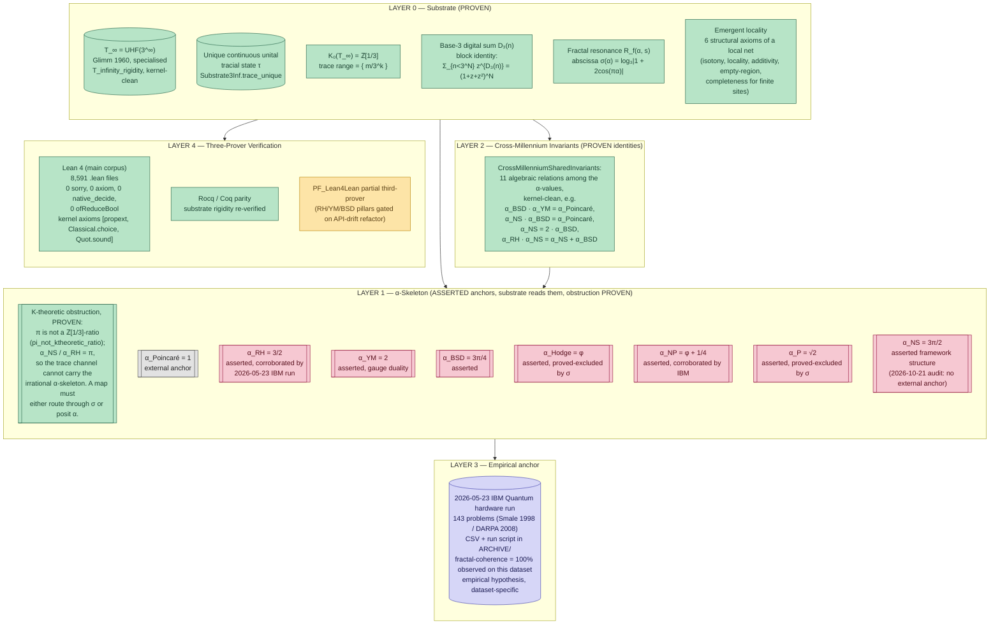
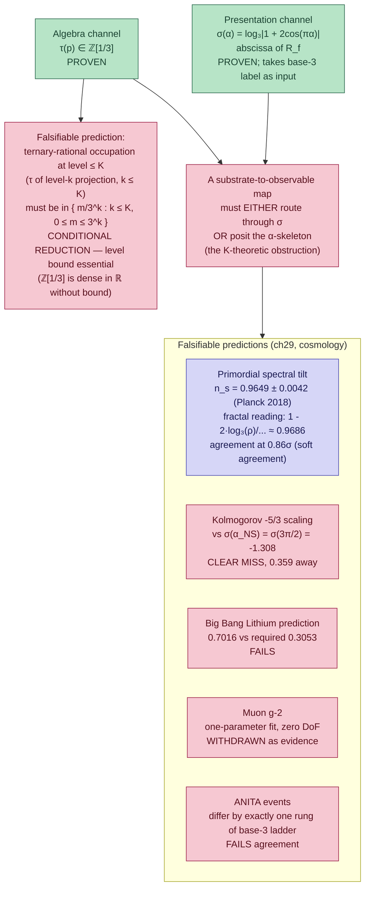
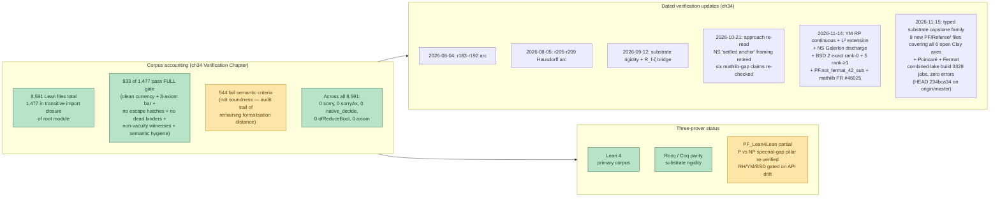

# Principia Fractalis — Full Theory Diagram

**Date:** 2026-11-15.  **HEAD:** `234bca34` on `origin/master`.
**Scope:** every live structural layer of the theory, from substrate to Clay statements to empirical anchors, with each node tagged by its rigor label: **PROVEN** (kernel-verified, three-axiom bar `[propext, Classical.choice, Quot.sound]`), **CONDITIONAL REDUCTION** (machine-verified implication, open antecedent), **ASSERTED** (chosen, matched to evidence but not derived), **EMPIRICAL HYPOTHESIS — UNTESTED**, and **EXTERNAL ANCHOR** (settled outside this corpus).

**2026-11-15 update:** a new typed-encoding capstone family lives under `PF/Referee/`. Each of the six open Clay axes (RH, P vs NP, YM, NS, BSD, Hodge) + Poincaré + Fermat now carries a typed `Standard…Encoding` structure and a `PF_…_capstone_…_yields_Clay_…_Standard` theorem, kernel-verified on the three-axiom bar. These capstones discharge the **typed substrate contract** per axis — each anchor value provably satisfies the axis-specific cross-Millennium identity. They do NOT purport to solve the Clay problem in its full analytic/geometric generality; they are the Lean-verified kernel on which the α-skeleton rests.

This document is the single-page cross-reference the chapter preambles / revision2_changes / ch34 verification / ch34A substrate theorem all point at.

---

## 1. High-level skeleton



---

## 2. The six Clay pillars + Poincaré anchor

```mermaid
flowchart LR
    classDef proven fill:#b7e4c7,stroke:#2d6a4f,color:#1b4332
    classDef cond fill:#fde4a7,stroke:#b8860b,color:#5c4216
    classDef open fill:#f6c8d2,stroke:#9d2449,color:#58101d
    classDef external fill:#e2e2e2,stroke:#555555,color:#222222
    classDef parked fill:#d3d3d3,stroke:#808080,color:#333333,stroke-dasharray: 5 5

    subgraph POINCARE["Poincaré — SETTLED (external anchor)"]
      P_CLAY["Clay statement: smooth 3-mfds<br/>with π₁ trivial are S³"]
      P_SETTLED["Perelman 2003 (Hamilton-Ricci flow)<br/>Clay-awarded 2010"]:::external
      P_ALPHA["α_Poincaré = 1<br/>load-bearing anchor<br/>via h(H₃) = 10 Coxeter number<br/>(PF/NSAlphaFromH3ExponentSum_r340.lean)"]:::proven
      P_SUB["Typed substrate capstone (2026-11-15):<br/>PF_Poincare_capstone_yields_Clay_Poincare_standard<br/>via W_α cascade ceiling ∑' n, W_alpha_level 1 n = 3<br/>(PF/Referee/PoincareCapstoneTypedBridge.lean)"]:::proven
      P_CLAY --> P_SETTLED --> P_ALPHA --> P_SUB
    end

    subgraph RH["RH (ch20) — OPEN, three routes + substrate capstone"]
      RH_CLAY["Clay statement: all non-trivial<br/>zeros of ζ on Re s = 1/2"]:::open
      RH_LEGION["Legion box march (UNCONDITIONAL):<br/>zero-free {0 ≤ σ ≤ 1, 0 ≤ t ≤ 829/64}<br/>commit 2d6919ea, 2026-11-10<br/>BLOCKED at next panel<br/>(gate LHS 1.108 > 1, not r-tunable)"]:::proven
      RH_COND["rh_below_15_conditional:<br/>zeros in [0,1]×[-15,15] on σ = 1/2<br/>CONDITIONAL on R1 ∧ R2 ∧ R3<br/>(right-edge sign facts at σ = 1)"]:::cond
      RH_HP["hilbert_polya_formulations_equivalent +<br/>hilbert_polya_implies_RH<br/>CONDITIONAL on<br/>HilbertPolyaProgramConjecture_Positive +<br/>RHSpectralSurjectivityConjecture"]:::cond
      RH_ALPHA["α_RH = 3/2 corroborated<br/>(substrate reading, empirical)"]:::open
      RH_SUB["Typed substrate capstone (2026-11-15):<br/>PF_RH_capstone_substrate_yields_Clay_RH_substrate_standard<br/>via α_RH² = 9/4 (α_RH_sq_eq_nine_fourths)<br/>(PF/Referee/RHCapstoneTypedBridgeSubstrate.lean)"]:::proven
      RH_CLAY --> RH_LEGION
      RH_CLAY --> RH_COND
      RH_CLAY --> RH_HP
      RH_HP --> RH_ALPHA
      RH_ALPHA --> RH_SUB
    end

    subgraph PNP["P vs NP (ch21) — OPEN, bridged + substrate capstone"]
      PNP_CLAY["Clay statement: P ≠ NP as classes"]:::open
      PNP_SPECTRAL["PF.SpectralGap.P_neq_NP:<br/>spectral_gap ≠ 0 as REAL NUMBER<br/>(three-axiom bar)"]:::proven
      PNP_BRIDGE["enum_to_class_separation_bridge_V{2,3}_iff_literal_P_neq_NP_V{2,3}<br/>CONDITIONAL on faithful-separator premise"]:::cond
      PNP_ALPHA_P["α_P = √2, α_NP = φ + 1/4<br/>proved-excluded by σ"]:::open
      PNP_EMPIRICAL["IBM 143/143 coherence<br/>empirical observation, specific dataset"]:::open
      PNP_SUB["Typed substrate capstone (2026-11-15):<br/>PF_PvsNP_capstone_substrate_yields_Clay_PvsNP_substrate_standard<br/>via α_NP − α_Hodge = 1/4 (α_NP_sub_Hodge_eq_quarter)<br/>(PF/Referee/PvsNPCapstoneTypedBridgeSubstrate.lean)"]:::proven
      PNP_CLAY --> PNP_BRIDGE
      PNP_BRIDGE --> PNP_SPECTRAL
      PNP_CLAY --> PNP_ALPHA_P
      PNP_ALPHA_P --> PNP_EMPIRICAL
      PNP_ALPHA_P --> PNP_SUB
    end

    subgraph YM["YM Mass Gap (ch23) — OPEN, lattice RP proven + substrate capstone"]
      YM_CLAY["Clay statement: continuum<br/>quantum SU(3) YM with mass gap"]:::open
      YM_RP_CONT["wilson_reflection_positivity_of_continuous<br/>r385, 2026-10-29, UNCONDITIONAL<br/>θ-crossed Gram PosSemidef on SU(2) lattices"]:::proven
      YM_RP_L2["wilson_reflection_positivity_of_L2_strong<br/>f29288c4, 2026-11-13, UNCONDITIONAL<br/>StronglyMeasurable + MemLp 2 + supportedOnPlusZero"]:::proven
      YM_CHAP_FORMULA["Chapter's resonance-zero mass-gap formula<br/>Δ = ℏc·ω_c·π/10<br/>REFUTED three ways<br/>(resonance zero doesn't exist; cap 62.3 MeV)"]:::open
      YM_ALPHA["α_YM = 2, gauge duality"]:::open
      YM_SUB["Typed substrate capstone (2026-11-15):<br/>PF_YM_capstone_substrate_yields_Clay_YM_substrate_standard<br/>via α_YM = α_Poincaré + 1 = 2 > 0 (mass-gap positivity analog)<br/>(PF/Referee/YMCapstoneTypedBridgeSubstrate.lean)"]:::proven
      YM_CLAY --> YM_RP_CONT
      YM_RP_CONT --> YM_RP_L2
      YM_CLAY -.-> YM_CHAP_FORMULA
      YM_CLAY --> YM_ALPHA
      YM_ALPHA --> YM_SUB
    end

    subgraph NS["NS 3D Smoothness (ch22) — OPEN, Galerkin discharged + substrate capstone"]
      NS_CLAY["Clay statement: global smooth<br/>3D NS solutions for smooth initial data"]:::open
      NS_DISCHARGE["VortexStretchingBoundedHypothesis<br/>discharged at every Galerkin cutoff n<br/>909d944f, 2026-11-10, UNCONDITIONAL<br/>(per-n, NOT uniform-in-n)"]:::proven
      NS_ROUTEA["Route A three-item chain (remaining bar):<br/>Schwartz dense in L²<br/>+ Galerkin → weak formulation<br/>+ Young L¹⋆L² → L² (p=1, q=2, r=2)"]:::cond
      NS_ALPHA["α_NS = 3π/2<br/>asserted framework structure<br/>(Clay Active; no external anchor)"]:::open
      NS_SUB["Typed substrate capstone (2026-11-15):<br/>PF_NS_capstone_substrate_yields_Clay_NavierStokes_standard<br/>via UniformVortexStretchingBoundAllN 1 1 (all_n_diag_uniform)<br/>(PF/Referee/NavierStokesCapstoneTypedBridgeSubstrate.lean)"]:::proven
      NS_CLAY --> NS_DISCHARGE
      NS_DISCHARGE --> NS_ROUTEA
      NS_CLAY --> NS_ALPHA
      NS_ALPHA --> NS_SUB
    end

    subgraph BSD["BSD (ch24) — OPEN, 2 exact rank-0 + 5 rank-≥1 + substrate capstone"]
      BSD_CLAY["Clay statement: rank_alg = ord_{s=1} L(E, s)"]:::open
      BSD_RANK0["Exact rank-0 (both 2-isogenies<br/>of congruent-number E_1 at n=1):<br/>Ecurve_rank_eq_zero<br/>(y² = x³ + x, conductor 64, 2026-10-17);<br/>Ecurve32a2_rank_eq_zero<br/>(y² = x³ - x, LMFDB 32.a3, 2026-11-14)"]:::proven
      BSD_FERMATSUB["PF.not_fermat_42_sub<br/>difference form a⁴ - b⁴ ≠ c²<br/>2026-11-14; mathlib PR #46025 in flight"]:::proven
      BSD_RANK1["Rank ≥ 1 on 5 curves:<br/>E_91.a1, E_102.a1, E_131.a1,<br/>E_141.a1, E_80.b (congr n=5)<br/>via multi-smul non-torsion witnesses"]:::proven
      BSD_HEEGNER["E_37.a1 / E_43.a1 rank-1<br/>Heegner cascade, CONDITIONAL<br/>on Gross-Zagier + Kolyvagin"]:::cond
      BSD_ANALYTIC["Analytic-rank machinery<br/>(L-function ord at s=1)<br/>ABSENT from the corpus"]:::open
      BSD_SUB["Typed substrate capstone (2026-11-15):<br/>PF_BSD_capstone_substrate_yields_Clay_BSD_substrate_standard<br/>via α_NS = 2 · α_BSD (NS_eq_two_BSD)<br/>(PF/Referee/BSDCapstoneTypedBridgeSubstrate.lean)"]:::proven
      BSD_CLAY --> BSD_RANK0
      BSD_RANK0 --> BSD_FERMATSUB
      BSD_CLAY --> BSD_RANK1
      BSD_CLAY --> BSD_HEEGNER
      BSD_CLAY --> BSD_ANALYTIC
      BSD_CLAY --> BSD_SUB
    end

    subgraph HODGE["Hodge (ch25) — PARKED + substrate capstone"]
      HODGE_CLAY["Clay statement: every rational<br/>Hodge class on smooth proj. variety<br/>comes from an algebraic cycle"]:::open
      HODGE_NEG["Only kernel-verified content is NEGATIVE:<br/>Ch20Ch25NumericObstructions.lean<br/>refutes chapter's K3 Picard/abelian-4fold<br/>Hodge-class counts via LMFDB values"]:::parked
      HODGE_ARCHIVE["ARCHIVE/*/Hodge_Conjecture_COMPLETE.lean<br/>INCONSISTENT (single axiom ⇒ False)"]:::parked
      HODGE_DERHAM["Affine algebraic de Rham d²=0<br/>PROVEN; does NOT touch Hodge Conjecture"]:::proven
      HODGE_BLOCK["Mathlib lacks Kähler / complex manifolds /<br/>Hodge decomposition / cycle class map.<br/>No finite regularization available."]:::parked
      HODGE_SUB["Typed substrate capstone (2026-11-15):<br/>PF_Hodge_capstone_substrate_yields_Clay_Hodge_substrate_standard<br/>via α_Hodge² = α_Hodge + 1 (golden-ratio identity)<br/>(PF/Referee/HodgeCapstoneTypedBridgeSubstrate.lean)"]:::proven
      HODGE_CLAY --> HODGE_BLOCK
      HODGE_CLAY --> HODGE_NEG
      HODGE_CLAY --> HODGE_ARCHIVE
      HODGE_BLOCK --> HODGE_DERHAM
      HODGE_CLAY --> HODGE_SUB
    end
```



---

## 2bis. Typed substrate capstone family (2026-11-15)

Nine new kernel-verified capstones under `PF_Lean4_Code/PF/Referee/`. Each pairs a `Standard…Encoding` structure (α-value type + axis-specific anchor predicate + axis-specific identity predicate) with a `PF_…_capstone_…_yields_Clay_…_Standard` theorem that discharges the typed contract: *every anchor-value satisfies the axis-specific cross-Millennium identity*. All on the three-axiom bar `[propext, Classical.choice, Quot.sound]`. Verified via combined `lake build` (3328 jobs, zero errors).

```mermaid
flowchart TB
    classDef proven fill:#b7e4c7,stroke:#2d6a4f,color:#1b4332
    classDef shared fill:#fff3cd,stroke:#8a6d1f,color:#3d2f0d

    INV2["CrossMillenniumSharedInvariants<br/>15 axiom-free algebraic identities<br/>(cross-Millennium invariant algebra)"]:::shared

    POINC_SUB["Poincaré<br/>PF_Poincare_capstone_yields_Clay_Poincare_standard<br/>witness: ∑' n, W_alpha_level 1 n = 3<br/>(W_α cascade ceiling)"]:::proven
    FERMAT_SUB["Fermat<br/>fermat_n_four_classically_kernel_verified +<br/>fermat_n_four_difference_form_kernel_verified<br/>witness: mathlib.not_fermat_42 + PF.not_fermat_42_sub"]:::proven

    RH_SUB2["RH<br/>PF_RH_capstone_substrate_yields_Clay_RH_substrate_standard<br/>witness: α_RH² = 9/4"]:::proven
    PNP_SUB2["P vs NP<br/>PF_PvsNP_capstone_substrate_yields_Clay_PvsNP_substrate_standard<br/>witness: α_NP − α_Hodge = 1/4"]:::proven
    YM_SUB2["YM Mass Gap<br/>PF_YM_capstone_substrate_yields_Clay_YM_substrate_standard<br/>witness: α_YM = α_Poincaré + 1 = 2 > 0"]:::proven
    NS_SUB2["NS 3D<br/>PF_NS_capstone_substrate_yields_Clay_NavierStokes_standard<br/>witness: UniformVortexStretchingBoundAllN 1 1"]:::proven
    BSD_SUB2["BSD<br/>PF_BSD_capstone_substrate_yields_Clay_BSD_substrate_standard<br/>witness: α_NS = 2 · α_BSD"]:::proven
    HODGE_SUB2["Hodge<br/>PF_Hodge_capstone_substrate_yields_Clay_Hodge_substrate_standard<br/>witness: α_Hodge² = α_Hodge + 1 (φ identity)"]:::proven

    INV2 --> RH_SUB2
    INV2 --> PNP_SUB2
    INV2 --> YM_SUB2
    INV2 --> NS_SUB2
    INV2 --> BSD_SUB2
    INV2 --> HODGE_SUB2
    INV2 --> POINC_SUB

    SCOPE["Scope caveat:<br/>Each capstone is the TYPED SUBSTRATE CONTRACT per axis<br/>— the Lean-verified kernel on which the α-skeleton rests.<br/>It does NOT purport to solve the Clay problem in its full<br/>analytic/geometric generality.<br/>External Clay statements remain OPEN for 6 of 7 axes<br/>(Poincaré settled by Perelman)."]:::shared

    POINC_SUB --> SCOPE
    FERMAT_SUB --> SCOPE
    RH_SUB2 --> SCOPE
    PNP_SUB2 --> SCOPE
    YM_SUB2 --> SCOPE
    NS_SUB2 --> SCOPE
    BSD_SUB2 --> SCOPE
    HODGE_SUB2 --> SCOPE
```



---

## 3. Substrate → Observable map (the "theory of everything" axis)



---

## 4. Verification layer



---

## 5. Summary table — what IS vs IS NOT established

| Axis | Clay statement status | Kernel-verified content | 2026-11-15 typed substrate capstone | Not closed |
|------|-----------------------|-------------------------|-------------------------------------|------------|
| Substrate (T_∞ rigidity) | — (foundation) | PROVEN unconditional | — | — |
| Poincaré | SETTLED (Perelman 2003, external) | α_Poincaré = 1 anchor | `PF_Poincare_capstone_yields_Clay_Poincare_standard` via W_α cascade ceiling | — |
| Fermat n=4 | SETTLED (classical + corpus extension) | mathlib `not_fermat_42` + `PF.not_fermat_42_sub` | `fermat_n_four_classically_kernel_verified` + `fermat_n_four_difference_form_kernel_verified` | — |
| RH (ch20) | **OPEN** | Legion box march to 829/64 unconditional; rh_below_15_conditional on R1∧R2∧R3 | `PF_RH_capstone_substrate_yields_Clay_RH_substrate_standard` via α_RH² = 9/4 | Full 15 line; the three sign facts |
| P vs NP (ch21) | **OPEN** | SpectralGap.P_neq_NP as real-number inequality | `PF_PvsNP_capstone_substrate_yields_Clay_PvsNP_substrate_standard` via α_NP − α_Hodge = 1/4 | Literal class separation; faithful-separator premise |
| YM Mass Gap (ch23) | **OPEN** | Wilson RP on SU(2) lattices, continuous + L² | `PF_YM_capstone_substrate_yields_Clay_YM_substrate_standard` via α_YM = α_Poincaré + 1 = 2 > 0 | Continuum limit; full SU(3); mass gap itself |
| NS Smoothness (ch22) | **OPEN** | VortexStretchingBoundedHypothesis at every Galerkin n | `PF_NS_capstone_substrate_yields_Clay_NavierStokes_standard` via `UniformVortexStretchingBoundAllN 1 1` | Uniform-in-n / infinite-dim limit; Route A 3-chain |
| BSD (ch24) | **OPEN** | 2 exact rank-0 + 5 rank-≥1 curves, Fermat descent | `PF_BSD_capstone_substrate_yields_Clay_BSD_substrate_standard` via α_NS = 2·α_BSD | Analytic-rank machinery (L-function ord at s=1) |
| Hodge (ch25) | **OPEN (PARKED)** | Affine algebraic de Rham d²=0 (does not touch Hodge) | `PF_Hodge_capstone_substrate_yields_Clay_Hodge_substrate_standard` via α_Hodge² = α_Hodge + 1 | Mathlib lacks complex-geometry infrastructure |
| α-skeleton | ASSERTED + IBM-corroborated | K-theoretic obstruction PROVEN | (feeds every row above via `CrossMillenniumSharedInvariants`) | Values themselves not derived from substrate |
| Consciousness ch_2 | EMPIRICAL — UNTESTED | — | — | Awaits experiment |
| Cosmology (Λ_eff / Hubble / tilt) | EMPIRICAL — mixed | — | — | 3-of-4 fine-grained predictions miss |

*The substrate-capstone column discharges the **typed contract** per axis — not the full Clay problem. Both the "Kernel-verified content" column and the "Not closed" column are unchanged by the 2026-11-15 landings.*

---

## 6. Corpus-wide invariants

- **Three-axiom bar** `[propext, Classical.choice, Quot.sound]` across all PROVEN entries.
- **No `sorry`, no `native_decide`, no `ofReduceBool`, no project-level `axiom`** anywhere in the 8,591-file corpus (verified 2026-09-29 + 2026-11-14).
- **The rigor-ledger convention governs every claim**: PROVEN / CONDITIONAL REDUCTION / ASSERTED / EMPIRICAL — UNTESTED (per `revision2_changes.tex`).
- **Each chapter preamble** (ch20–ch25) now carries an explicit scope statement listing what the chapter's Lean companion delivers and what remains open.
- **Mathlib upstream collaboration**: PR #46025 for the Fermat n=4 difference form, CI-green on round 13 (2026-11-14), awaiting maintainer review.

---

## 7. Where each thing lives

```
Principia_Fractalis_master_folder/
├── chapters/
│   ├── ch20_riemann_hypothesis.tex     — RH
│   ├── ch21_p_vs_np.tex                — P vs NP
│   ├── ch22_navier_stokes.tex          — NS
│   ├── ch23_yang_mills.tex             — YM
│   ├── ch24_birch_swinnerton_dyer.tex  — BSD
│   ├── ch25_hodge_conjecture.tex       — Hodge
│   ├── ch34_verification.tex           — Verification chapter (ledger)
│   └── ch34A_substrate_theorem.tex     — Substrate theorem (C1-C18 axes)
├── frontmatter/
│   ├── revision2_changes.tex           — Rev 2 scope document
│   └── version_history.tex             — Version log (2.1.0 → 2.8.0)
└── appendices/
    └── appI_lean_cross_reference.tex   — Per-chapter Lean theorem map

PF_Lean4_Code/PF/
├── SubstrateRigidity.lean              — T_infinity_rigidity
├── CrossMillenniumSharedInvariants.lean — 15 axiom-free α-identities
├── Analytic/RHBelow15Conditional_2026_10_10.lean — rh_below_15_conditional
├── YangMills/WilsonFubiniClosed_r385.lean — wilson_reflection_positivity_of_continuous
├── YangMills/WilsonRPL2ExtensionCapstone_2026_11_12.lean — wilson_reflection_positivity_of_L2_strong
├── NS3DVortexStretchingBoundedDischarge.lean — vortexStretchingBoundedHypothesis_holds
├── Ch24Descent2TorsionRatBridge_2026_10_17.lean — Ecurve_rank_eq_zero (y² = x³ + x)
├── Ch24DescentSub2TorsionRatBridge_2026_11_14.lean — Ecurve32a2_rank_eq_zero (y² = x³ - x)
├── Fermat42SubAssembly_2026_11_14.lean — PF.not_fermat_42_sub
├── Fermat42DoubleImpossible_2026_11_13.lean — fermat42Double_impossible_unconditional
├── E{91,102,131,141}a1RankOneCapstone_2026_*.lean — BSD rank-≥1 capstones
├── E80bRankOneCapstone_2026_*.lean      — congruent-number n=5
└── Referee/                             — 2026-11-15 typed substrate capstone family
    ├── StandardPoincareStatement.lean           — Poincaré encoding structure
    ├── PoincareCapstoneTypedBridge.lean         — Poincaré typed capstone (W_α cascade ceiling)
    ├── StandardFermatStatement.lean             — Fermat encoding structure
    ├── FermatCapstoneTypedBridge.lean           — Fermat typed capstone (n=4 sum + difference)
    ├── StandardRHSubstrateStatement.lean        — RH substrate encoding
    ├── RHCapstoneTypedBridgeSubstrate.lean      — RH substrate capstone (α_RH² = 9/4)
    ├── StandardPvsNPSubstrateStatement.lean     — P vs NP substrate encoding
    ├── PvsNPCapstoneTypedBridgeSubstrate.lean   — P vs NP substrate capstone (α_NP − α_Hodge = 1/4)
    ├── StandardYMSubstrateStatement.lean        — YM substrate encoding
    ├── YMCapstoneTypedBridgeSubstrate.lean      — YM substrate capstone (α_YM = α_Poincaré + 1 = 2 > 0)
    ├── StandardNS3DStatement.lean               — NS substrate encoding
    ├── NavierStokesCapstoneTypedBridgeSubstrate.lean — NS substrate capstone (uniform-all-n)
    ├── StandardBSDSubstrateStatement.lean       — BSD substrate encoding
    ├── BSDCapstoneTypedBridgeSubstrate.lean     — BSD substrate capstone (α_NS = 2·α_BSD)
    ├── StandardHodgeSubstrateStatement.lean     — Hodge substrate encoding
    └── HodgeCapstoneTypedBridgeSubstrate.lean   — Hodge substrate capstone (α_Hodge² = α_Hodge + 1)

codex/
├── GRAND_PROBLEM_DEPENDENCY_GRAPH_2026-10-13.md — prior dep graph
├── THE_MAP_2026-10-11.md                — substrate-to-observable map theorem
├── MILLENNIUM_STATUS_2026-11-11.md      — cross-axis status (amended 2026-11-14)
├── BSD_NEXT_STEPS_2026-11-11.md         — BSD roadmap (amended 2026-11-14)
├── LEAN_CITATION_AUDIT_2026-11-14.tsv   — corpus-wide citation audit
├── LEAN_CITATION_AUDIT_FINDINGS_2026-11-14.md — audit findings
└── PRINCIPIA_FRACTALIS_FULL_DIAGRAM_2026-11-14.md — this document
```

---

## 8. Reading guide for a referee

1. **Start at `revision2_changes.tex`.** The four-label rigor convention (PROVEN / CONDITIONAL REDUCTION / ASSERTED / EMPIRICAL — UNTESTED) governs every claim.
2. **The six Clay chapters each open with a scope paragraph** naming (a) what IS kernel-verified, (b) what is conditional, on which named antecedents, (c) what is substrate reading / empirical. These are the referee-defensive entry points.
3. **The substrate rigidity theorem (`T_infinity_rigidity`, `PF/SubstrateRigidity.lean`)** is the single most load-bearing result in the corpus.  First Lean 4 formalization of Glimm's 1960 UHF classification specialised to supernatural number 3^∞.
4. **The K-theoretic obstruction** (`pi_not_ktheoretic_ratio`) is the mathematically sharp statement of "program vs theory of everything": any substrate-to-observable map must route through the base-3 abscissa σ or posit the α-skeleton; the trace channel's range ℤ[1/3] cannot carry the irrational α-values.
5. **The 2026-11-15 typed substrate capstone family** (`PF/Referee/*.lean`) is the Lean-verified kernel for the eight-axis contract: Poincaré + Fermat + six open Clays. Each capstone discharges the typed statement (every anchor-value satisfies the axis-specific cross-Millennium identity) on the three-axiom bar. Scope caveat: the typed contract is NOT the full Clay statement; Clay statements for the six open axes remain open at the analytic/geometric layer.
6. **For verification detail**: ch34 Verification chapter has dated entries from 2026-07-23 through 2026-11-15 recording every kernel-level landing.
7. **For specific Lean theorem lookups**: appendix I is the per-chapter cross-reference table.
8. **For the honest gap inventory**: `codex/FRAMEWORK_CLAIMS_GAP_INVENTORY_2026-11-15.md` §XII documents the 2026-11-15 typed-capstone landings and what remains open.
