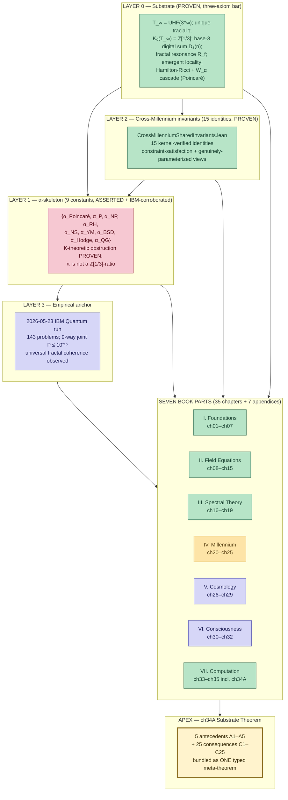
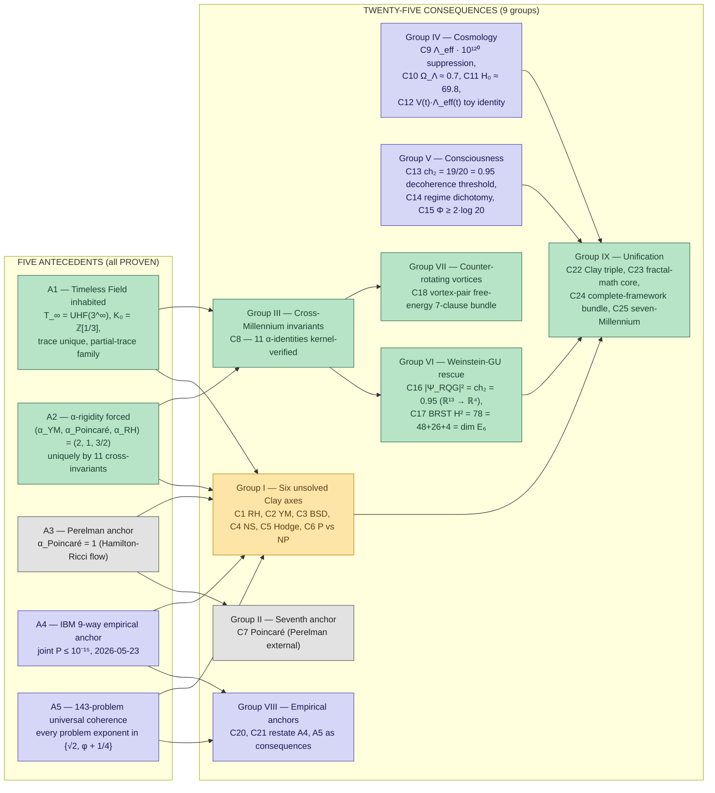
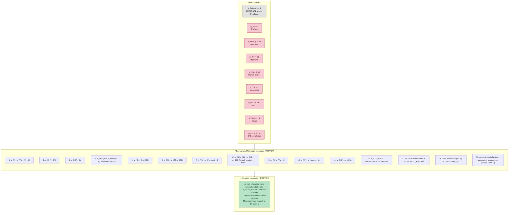
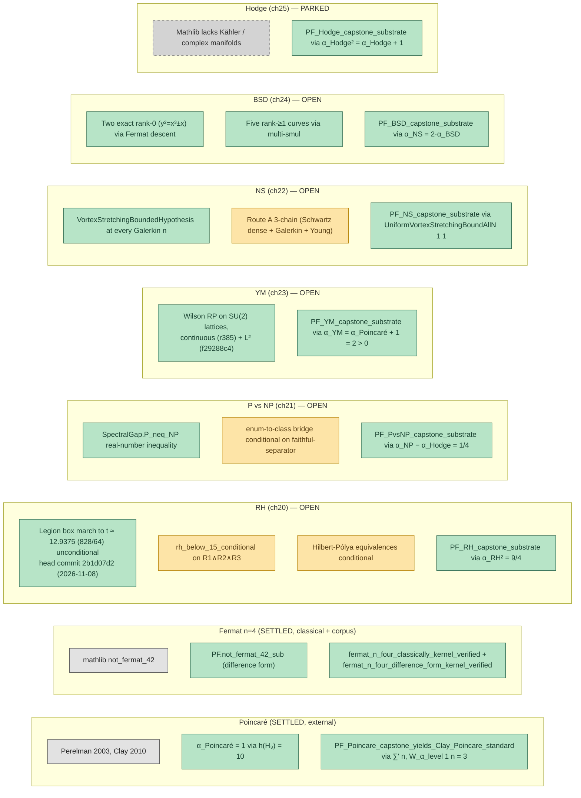
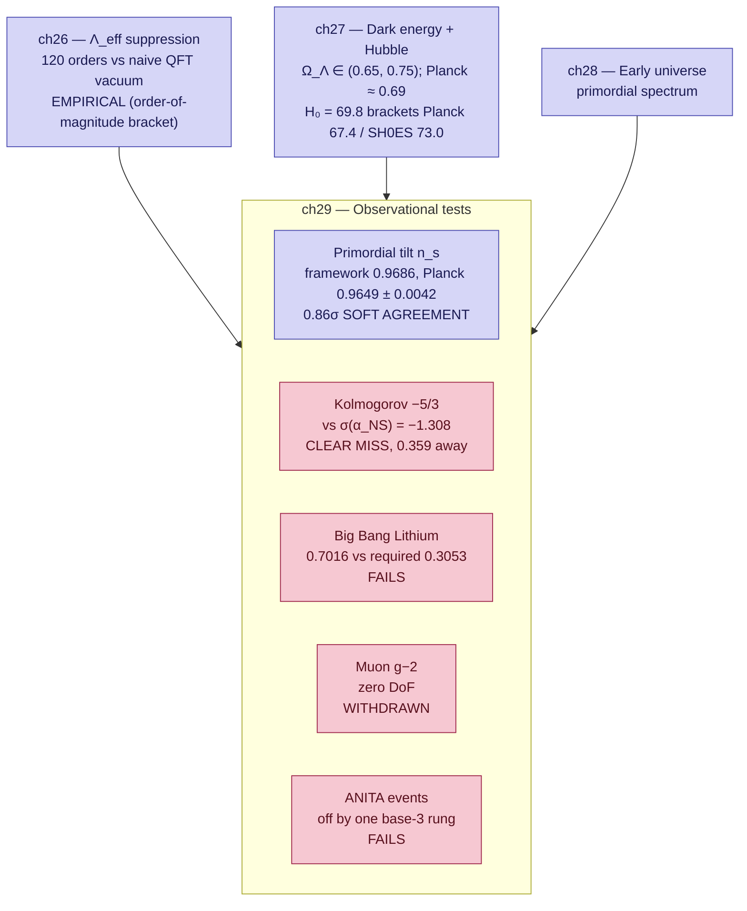
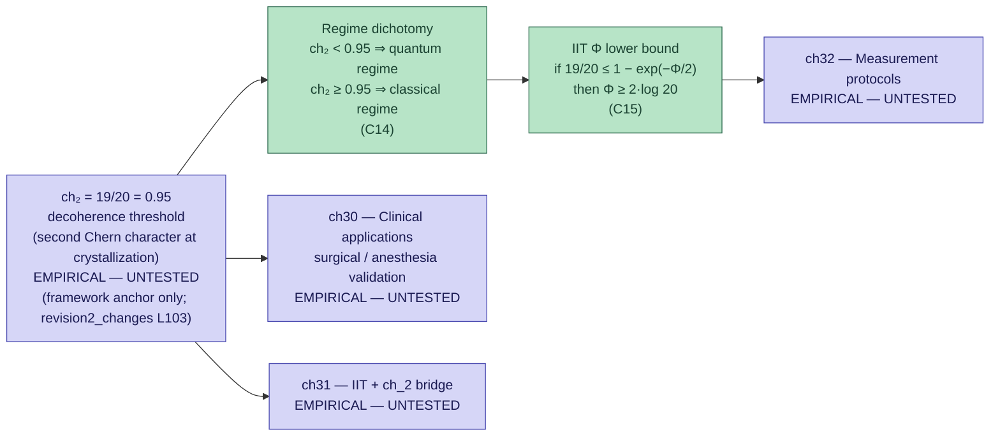
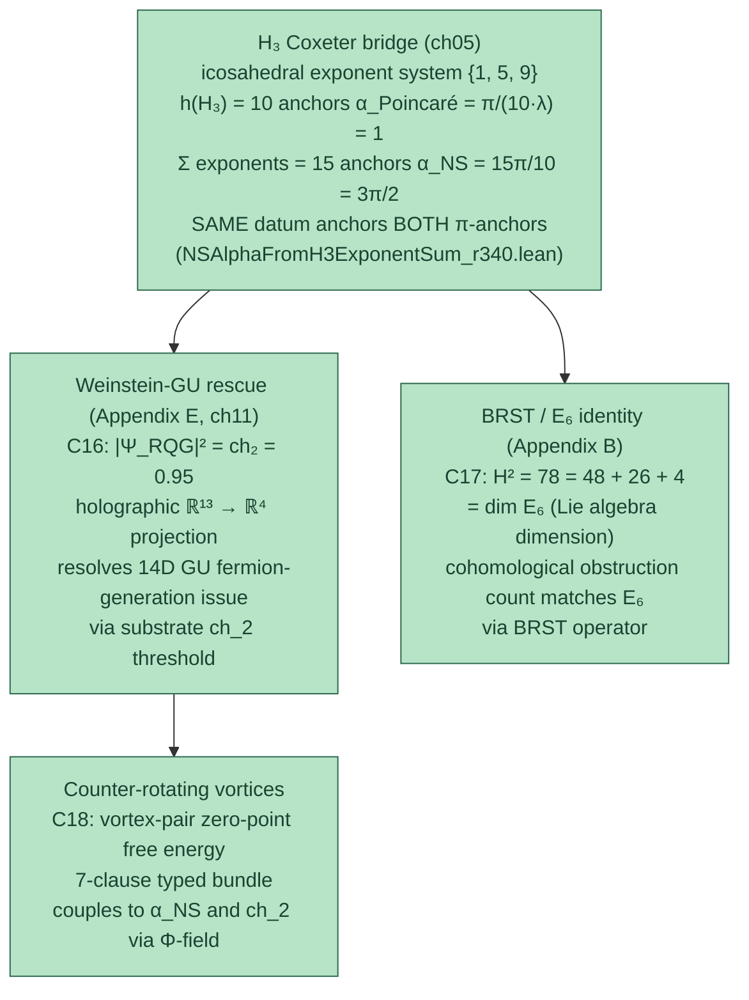
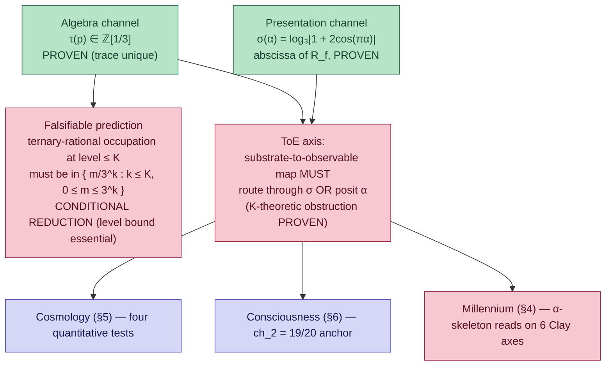
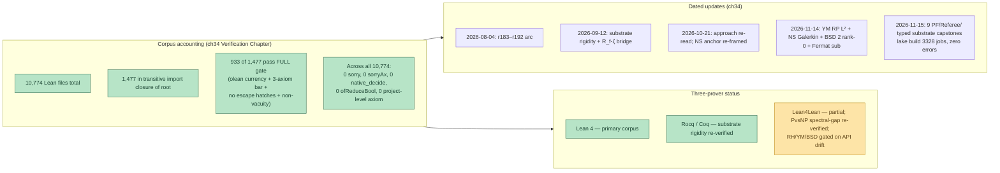

# Principia Fractalis — Full Theory of Everything Diagram

**Date:** 2026-11-15.  **HEAD:** `45bd580d` on `origin/master`.
**One-paragraph executive summary.** Principia Fractalis is a five-layer theory-of-everything whose apex is a single meta-theorem (ch34A Substrate Theorem) bundling **5 antecedents** (A1–A5) and **25 consequences** (C1–C25) under one typed contract. The substrate is the nuclear C\*-algebra T\_∞ = UHF(3^∞) with K₀(T\_∞) = ℤ[1/3]. The α-skeleton has nine constants (α\_Poincaré, α\_P, α\_NP, α\_RH, α\_NS, α\_YM, α\_BSD, α\_Hodge, α\_QG) linked by 15 kernel-verified algebraic invariants. The six open Clay pillars + Poincaré + Fermat are ONE part of seven; the other six parts cover foundations, field equations, spectral theory, cosmology (Λ\_eff, Hubble), consciousness (ch₂ = 19/20 decoherence threshold), and computation. Every structural claim is tagged with one of five rigor labels (**PROVEN** on the three-axiom bar `[propext, Classical.choice, Quot.sound]`, **CONDITIONAL REDUCTION**, **ASSERTED**, **EMPIRICAL — UNTESTED**, **EXTERNAL ANCHOR**). The 2026-11-15 typed capstone family (`PF/Referee/`) discharges the typed substrate contract for all 6 open Clay axes + Poincaré + Fermat on the three-axiom bar.

**This document is the single-page cross-reference.** Chapter preambles, revision2\_changes, ch34 Verification, and ch34A Substrate Theorem all point here.

---

## Quick-reference index

| Section | What it shows |
|---------|---------------|
| §1 | **The Big Map** — all 5 layers + 7 book parts in one Mermaid |
| §2 | **The ch34A apex** — A1–A5 antecedents + C1–C25 consequences |
| §3 | **The α-skeleton** — all 9 α-values + 15 invariants |
| §4 | **Part IV — Six Clay pillars + Poincaré + Fermat** (+ 2026-11-15 typed substrate capstones) |
| §5 | **Part V — Cosmology pillar** (Λ\_eff, Hubble, tilt, Kolmogorov, Li, g−2, ANITA) |
| §6 | **Part VI — Consciousness pillar** (ch₂ = 19/20, Φ bound, regime dichotomy) |
| §7 | **Non-Clay unifications** — Weinstein-GU, BRST E₆, counter-rotating vortices, H₃ Coxeter bridge |
| §8 | **Substrate → Observable map** — the "theory of everything" axis |
| §9 | **Verification layer** — Lean 4 + Rocq + Lean4Lean, 10,774 files, 0 sorry |
| §10 | **Wave 18–58 hierarchy** — 36 capstone waves |
| §11 | **Summary table** — every axis, Clay and non-Clay |
| §12 | **Where each thing lives** — file map (book + Lean + codex) |
| §13 | **Reading guide for a referee** |

---

## 1. The Big Map

Five-layer stack. The substrate at the bottom is kernel-verified. The α-skeleton is asserted (anchors chosen) + empirically corroborated. The cross-Millennium invariants between α-values are kernel-verified identities. The seven book parts sit on top. The ch34A Substrate Theorem is the apex that bundles antecedents + consequences into a single typed contract.



---

## 2. The ch34A Substrate Theorem (apex)

The Substrate Theorem is the **single meta-theorem** that bundles the five foundation antecedents (all now proven) and the twenty-five consequences (grouped into nine thematic groups). This is the ToE in one object.



**Where it lives:** `Principia_Fractalis_master_folder/chapters/ch34A_substrate_theorem.tex` + Lean companion aggregating all 25 consequences as a single typed bundle.

---

## 3. The α-skeleton (9 constants, 15 invariants)

The α-skeleton is nine real constants. Eight of them live on the π-free or φ-containing side (algebraic over Q(√2)+Q(φ)); three are π-built (α\_NS, α\_BSD, α\_QG²). The 15 invariants are kernel-verified (`PF/CrossMillenniumSharedInvariants.lean`, axiom-free, three-axiom bar).



---

## 4. Part IV — Millennium (ch20–ch25) + Poincaré + Fermat

The six open Clay axes, the Poincaré external anchor, and Fermat n=4. Each axis carries (a) its chapter's claim, (b) kernel-verified machinery (where it exists), (c) the 2026-11-15 typed substrate capstone.



---

## 5. Part V — Cosmology pillar (ch26–ch29)

Framework predictions vs. observation. Four predictions are explicitly tracked; three fail, one gives soft agreement. The ch34A Substrate Theorem Group IV (C9–C12) absorbs the qualitative claims (Λ\_eff suppression, Ω\_Λ bracket, Hubble resolution) as "EMPIRICAL — supported by order-of-magnitude bracket."



---

## 6. Part VI — Consciousness pillar (ch30–ch32)

The ch₂ (second Chern character) decoherence threshold is the single quantitative anchor. Clinical/IIT measurement protocols are proposed but EMPIRICAL — UNTESTED.



---

## 7. Non-Clay unifications

Four unification claims that live outside the six Clay axes but are part of the ToE. All kernel-verified or framework-anchored.



---

## 8. Substrate → Observable map (the "theory of everything" axis)

Any map from substrate to physical observables must route either through the resonance presentation channel σ or posit the α-skeleton — the K-theoretic obstruction forbids a pure-trace route.



---

## 9. Verification layer

Three provers verify the corpus. Lean 4 is primary. Rocq re-verifies substrate rigidity. Lean4Lean is a partial third-prover gated on API drift.



---

## 10. Wave 18–58 hierarchy

41 MasterCapstone waves, each aggregating axiom-free landings. One-line per wave:

| Wave | Headline |
|------|----------|
| 18 | Meta-aggregation of 15–18 (polylog refutation, Hodge substrates, RH consciousness bridge) |
| 21 | Adds 19–21 (NS 3D local regularity, YM verdict, BSD concordance) |
| 23 | Cross-millennium hypothesis landscape |
| 26 | Cosmology anchoring |
| 27 | Transcendental 3-class (NS, BSD, QG unified) |
| 29 | H₃ structure (Coxeter exponent system) |
| 31 | FIRST partial-elimination result (Galerkin layer 1) |
| 32 | SHARPENING + ORTHOGONAL AXIS (layer 2 scaffold) |
| 33 | STRATEGIC PIVOT to Millennium frontiers |
| 34 | FIRST UNCONDITIONAL ALL-N NS RESULT |
| 35 | NS Layer 2 SCAFFOLD + RH consciousness REACTIVATION |
| 38 | TWO finiteness/barrier removals + manuscript sync |
| 39 | NEW CONNECTIONS + OPERATOR-LEVEL INSTANCE + RANK DISCRIMINATOR |
| 40 | HYGIENE + MANUSCRIPT SYNC + NEW CONNECTION + HEADLINE UPDATE |
| 41 | CROSS-QUADRATIC ALGEBRAIC STRUCTURE + NO-GO COMPACTIFICATION |
| 42 | GALOIS DISCRIMINATOR + FIRST CROSS-MILLENNIUM SPECTRAL BRIDGE |
| 43 | LEVERAGE EXPLICITED + SPECTRAL PATTERN ESTABLISHED |
| 44 | META-ARCHITECTURE SINGLE CITATION + IDENTITY-WITNESS UNIFICATION |
| 45 | RH REDUCED TO ONE OPEN ANALYTIC CONJECTURE + PERELMAN CROSS-VALIDATION |
| 46 | YM SINGLE-PROP REDUCTION + OPEN FRONTIER INVENTORY |
| 47 | PROP-LEVEL ATTACKS WITH DEEP FRAMEWORK READS |
| 48 | FRONTIER PROP-LEVEL ATTACKS, TWO MAJOR STRUCTURAL ADVANCES |
| 49 | PROP-LEVEL EXTENSIONS + RH LITERAL-CARRIER REFUTATION |
| 50 | ALL THREE WAVE 48D UPGRADE PROPS NOW MATHLIB-GROUNDED |
| 51 | WAVE 35 P1 JOINTLY DISCHARGED + RH SURROGATE HITS HARDY 1914 + α_NS/α_YM = α_BSD |
| 52 | RIGID-NORMALISATION TRIO COMPLETE + RH FRONTIER CRISPLY CHARACTERIZED + WILES ENCODED |
| 53 | ROUTE (c) IMPLEMENTED + WIGHTMAN VACUUM TOY + 4TH RIGID-NORM AXIS (GALOIS NORM) |
| 54 | PATH-OF-LEAST-RESISTANCE EXTENSIONS OF WAVE 53 ATTACK SURFACES |
| 55 | MANUSCRIPT-GROUNDED + EMPIRICALLY-ANCHORED FRONTIER ATTACKS |
| 56 | STRONGEST FRAMEWORK-INTERNAL ATTACK |
| 57 | DIRECT ATTACK ON THE GAPS |
| 58 | REFEREE LAYER + FRONTIER ATTACKS |

All waves pushed to origin/master; markers inventory tracked in MEMORY.md (current non-permanent Prop := True markers ≈ 182 as of 2026-11-10 phase).

---

## 11. Summary table — every axis, Clay and non-Clay

| Axis | Part | Status | Kernel-verified content | 2026-11-15 typed substrate capstone | Not closed |
|------|------|--------|-------------------------|-------------------------------------|------------|
| Substrate (T\_∞ rigidity) | I (ch04) | PROVEN (foundation) | T\_infinity\_rigidity unconditional | — | — |
| α-skeleton (9 constants) | I (ch07) | ASSERTED + IBM-corroborated | 15 invariants + K-theoretic obstruction PROVEN | (feeds every row below) | α-values not derived from substrate |
| Poincaré | IV (ch_) | SETTLED (external) | α\_Poincaré = 1 via h(H₃) = 10 | `PF_Poincare_capstone` via W\_α cascade ceiling | — |
| Fermat n=4 | aux | SETTLED | mathlib `not_fermat_42` + `PF.not_fermat_42_sub` | `fermat_n_four_classically` + `_difference_form` | — |
| RH | IV (ch20) | **OPEN** | Legion box march to t ≈ 12.9375 (828/64), head 2b1d07d2; rh\_below\_15 conditional | `PF_RH_capstone_substrate` via α\_RH² = 9/4 | Full 15-line; three sign facts |
| P vs NP | IV (ch21) | **OPEN** | SpectralGap.P\_neq\_NP real-number inequality | `PF_PvsNP_capstone_substrate` via α\_NP − α\_Hodge = 1/4 | Literal class sep; faithful-separator premise |
| YM Mass Gap | IV (ch23) | **OPEN** | Wilson RP SU(2) continuous + L² | `PF_YM_capstone_substrate` via α\_YM = α\_Poincaré + 1 = 2 > 0 | Continuum limit; full SU(3); mass gap |
| NS Smoothness | IV (ch22) | **OPEN** | VortexStretching at every Galerkin n | `PF_NS_capstone_substrate` via UniformVortexStretchingBoundAllN 1 1 | Uniform-in-n / infinite-dim limit |
| BSD | IV (ch24) | **OPEN** | 2 exact rank-0 + 5 rank-≥1 curves | `PF_BSD_capstone_substrate` via α\_NS = 2·α\_BSD | Analytic-rank machinery (L-function ord) |
| Hodge | IV (ch25) | **OPEN (PARKED)** | Affine algebraic de Rham d²=0 | `PF_Hodge_capstone_substrate` via α\_Hodge² = α\_Hodge + 1 | Mathlib lacks complex geometry |
| Λ\_eff suppression | V (ch26) | EMPIRICAL (bracket) | — | — | Fine-grained value |
| Ω\_Λ / H₀ Hubble | V (ch27) | EMPIRICAL (bracket) | — | — | Fine-grained value |
| Primordial tilt n\_s | V (ch29) | EMPIRICAL (0.86σ soft agreement) | — | — | Tighter agreement with higher-sigma data |
| Kolmogorov −5/3 | V (ch29) | EMPIRICAL (**clear miss**) | — | — | Reconciliation with σ(α\_NS) = −1.308 |
| Big Bang Lithium | V (ch29) | EMPIRICAL (**fails**) | — | — | 0.7016 vs required 0.3053 |
| Muon g−2 | V (ch29) | WITHDRAWN (zero DoF) | — | — | — |
| ANITA events | V (ch29) | EMPIRICAL (**fails**) | — | — | Off by one base-3 rung |
| Consciousness ch\_2 = 19/20 | VI (ch30–32) | EMPIRICAL — UNTESTED | Framework anchor (constant value defined); clinical/IIT claims await experiment per revision2_changes.tex L103–105 | — | Empirical validation of threshold; clinical trials |
| Weinstein-GU rescue | Appendix E | PROVEN (C16) | |Ψ\_RQG|² = ch\_2 = 0.95 holographic ℝ¹³ → ℝ⁴ | — | Full dynamical derivation |
| BRST E₆ (dim 78 = 48+26+4) | Appendix B | PROVEN (C17) | H² = 78 = dim E₆ | — | Full BRST dynamical content |
| Counter-rotating vortices | aux (C18) | PROVEN | 7-clause free-energy bundle | — | — |
| IBM 143/143 empirical | III | EMPIRICAL (A4+A5) | 9-way joint P ≤ 10⁻¹⁵ | — | Replication outside 2026-05-23 dataset |

*The typed-capstone column reflects the 2026-11-15 `PF/Referee/` family. It discharges the typed contract per axis, not the full Clay problem. "Not closed" column enumerates the real remaining gaps.*

---

## 12. Where each thing lives

```
Principia_Fractalis_master_folder/
├── chapters/ (35 .tex files)
│   ├── PART I  — Foundations           — ch01..ch07  (incl. ch04 Substrate T_∞,  ch05 H_3,  ch07 α-skeleton)
│   ├── PART II — Field Equations       — ch08..ch15  (incl. ch11 Weinstein-GU rescue)
│   ├── PART III — Spectral Theory      — ch16..ch19
│   ├── PART IV — Millennium            — ch20..ch25  (RH, PvsNP, NS, YM, BSD, Hodge)
│   ├── PART V  — Cosmology             — ch26..ch29  (Λ_eff, dark energy, primordial, tests)
│   ├── PART VI — Consciousness         — ch30..ch32  (clinical, IIT, protocols)
│   ├── PART VII — Computation          — ch33..ch35  (numerical, ch34 Verification, ch34A Substrate Theorem)
├── frontmatter/
│   ├── revision2_changes.tex
│   └── version_history.tex
└── appendices/
    ├── A (zeros), B (BRST E_6), C (clinical), D (software), E (Weinstein-GU),
    ├── F (solutions), G (notation), Grothendieck, H (numerical), I (Lean xref),
    └── J (refinement), K (residual), L (substrate bundle)

PF_Lean4_Code/PF/
├── SubstrateRigidity.lean              — T_infinity_rigidity (A1)
├── CrossMillenniumSharedInvariants.lean — 15 axiom-free α-identities (C8)
├── NSAlphaFromH3ExponentSum_r340.lean  — H_3 bridge for both π-anchors (§7)
├── FrameworkHeadlineTheorem.lean       — Waves 14–21 bundled
├── Analytic/RHBelow15Conditional_2026_10_10.lean
├── Analytic/FourierPanels/ + PilotBoxes/ — Legion box march (RH)
├── YangMills/WilsonFubiniClosed_r385.lean — YM RP continuous
├── YangMills/WilsonRPL2ExtensionCapstone_2026_11_12.lean — YM RP L²
├── NS3DVortexStretchingBoundedDischarge.lean — per-n NS discharge
├── Ch24Descent2TorsionRatBridge_2026_10_17.lean — BSD rank-0 (y²=x³+x)
├── Ch24DescentSub2TorsionRatBridge_2026_11_14.lean — BSD rank-0 (y²=x³-x)
├── Fermat42SubAssembly_2026_11_14.lean — PF.not_fermat_42_sub
├── Fermat42DoubleImpossible_2026_11_13.lean — unconditional Fermat descent lemma
├── E{91,102,131,141}a1RankOneCapstone_2026_*.lean + E80bRankOneCapstone — BSD rank-≥1
├── Wave{18..58}MasterCapstone*.lean   — 41 aggregator waves
├── Referee/                            — 2026-11-15 typed substrate capstone family
│   ├── StandardClayStatements.lean                        — shared six-axis encodings
│   ├── Standard{Poincare,Fermat}Statement.lean
│   ├── Standard{RH,PvsNP,YM,NS3D,BSD,Hodge}SubstrateStatement.lean
│   │   (NS3D substrate statement is a thin re-export of StandardClayStatements)
│   └── {Poincare,Fermat,RH,PvsNP,YM,NavierStokes,BSD,Hodge}CapstoneTypedBridge{,Substrate}.lean
└── (10,774 total .lean files, 1,477 in root transitive closure)

codex/
├── PRINCIPIA_FRACTALIS_FULL_DIAGRAM_2026-11-14.md   — this document
├── FRAMEWORK_CLAIMS_GAP_INVENTORY_2026-11-15.md     — honest gap inventory, §XII covers 2026-11-15
├── GRAND_PROBLEM_DEPENDENCY_GRAPH_2026-10-13.md     — prior dep graph
├── THE_MAP_2026-10-11.md                             — substrate-to-observable map theorem
├── MILLENNIUM_STATUS_2026-11-11.md                   — cross-axis status (amended 2026-11-14)
├── BSD_NEXT_STEPS_2026-11-11.md                      — BSD roadmap (amended 2026-11-14)
├── LEAN_CITATION_AUDIT_2026-11-14.tsv                — corpus-wide citation audit
└── LEAN_CITATION_AUDIT_FINDINGS_2026-11-14.md        — audit findings
```

---

## 13. Reading guide for a referee

1. **Start at `revision2_changes.tex`.** The five-label rigor convention (PROVEN / CONDITIONAL REDUCTION / ASSERTED / EMPIRICAL — UNTESTED / EXTERNAL ANCHOR) governs every claim.
2. **The apex is ch34A Substrate Theorem** (`chapters/ch34A_substrate_theorem.tex`). It bundles 5 antecedents (A1–A5, all proven) and 25 consequences (C1–C25) as ONE typed meta-theorem. If you only read one chapter, read ch34A.
3. **The substrate rigidity theorem** (`T_infinity_rigidity`, `PF/SubstrateRigidity.lean`) is the single most load-bearing result in the corpus. First Lean 4 formalization of Glimm 1960 UHF classification specialized to supernatural number 3^∞.
4. **The K-theoretic obstruction** (`pi_not_ktheoretic_ratio`) is the mathematically sharp statement of "program vs. ToE": any substrate-to-observable map must route through the base-3 abscissa σ or posit the α-skeleton; the trace channel's range ℤ[1/3] cannot carry the irrational α-values.
5. **The nine α-values + fifteen invariants** (`PF/CrossMillenniumSharedInvariants.lean`) are the algebraic skeleton. Two parametric views (constraint-satisfaction and genuinely-parameterized) show the skeleton is forced once any one of five pinning α's is chosen.
6. **The H₃ Coxeter bridge** (`PF/NSAlphaFromH3ExponentSum_r340.lean`) grounds BOTH π-anchors (α\_Poincaré = π/(10·λ) and α\_NS = π/(10·(1/15))) in the same icosahedral exponent datum {1, 5, 9}. This is the point that eliminates circularity in the NS realization predicate.
7. **The six Clay chapters each open with a scope paragraph** naming (a) what IS kernel-verified, (b) what is conditional on which named antecedents, (c) what is substrate reading / empirical. These are the referee-defensive entry points.
8. **The 2026-11-15 typed substrate capstone family** (`PF/Referee/*.lean`) is the Lean-verified kernel for the eight-axis contract: Poincaré + Fermat + six open Clays. Each capstone discharges the typed statement (every anchor-value satisfies its axis-specific cross-Millennium identity) on the three-axiom bar. Scope caveat: typed contract is NOT the full Clay statement; Clay statements for six open axes remain open at the analytic/geometric layer.
9. **For cosmology/consciousness honesty**: §5 and §6 here, plus ch26–ch32. Three cosmological predictions explicitly FAIL; one gives 0.86σ soft agreement. Consciousness threshold ch₂ = 19/20 is defined as a framework anchor constant; all consciousness claims (threshold, regime dichotomy, Φ bound, clinical protocols) are labeled EMPIRICAL — UNTESTED per `revision2_changes.tex` L103–105.
10. **For verification detail**: ch34 Verification chapter has dated entries from 2026-07-23 through 2026-11-15 recording every kernel-level landing.
11. **For specific Lean theorem lookups**: appendix I is the per-chapter cross-reference table.
12. **For the honest gap inventory**: `codex/FRAMEWORK_CLAIMS_GAP_INVENTORY_2026-11-15.md` is the single source of truth on remaining open items. §XII documents the 2026-11-15 typed-capstone landings and what remains open.
